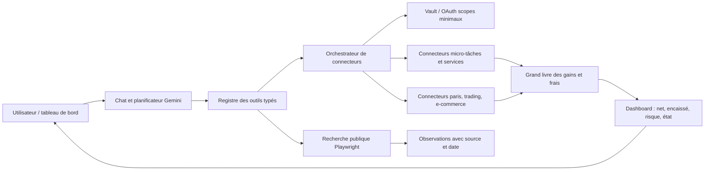

# Conception : worker Verox orienté opportunités et comptes autorisés

## Objectif produit

Verox est un outil personnel qui repère des opportunités, estime leur intérêt,
organise les tâches et suit les résultats pour son propriétaire. Gemini raisonne
et choisit parmi des outils explicitement déclarés. Les connecteurs travaillent
avec les capacités réellement offertes par chaque service.

« Agressif » signifie ici couvrir régulièrement le catalogue, rafraîchir les
données, prioriser les occasions selon rendement estimé, délai, effort et
éligibilité, puis exécuter les opérations que le connecteur et les règles du
service autorisent. Cela ne signifie pas promettre un revenu ou supposer qu'une
tâche, une cote ou un produit est rentable.

## Trois plans distincts

1. **Recherche publique (OSINT)** — Playwright sans compte pour lire les pages
   publiques d'un registre. Les observations sont sourcées, datées et déclarées
   non vérifiées jusqu'à validation.
2. **Compte personnel** — connecteur spécifique et autorisé par la plateforme,
   de préférence API officielle ou OAuth avec les permissions minimales.
   Playwright ne sert qu'aux interfaces dont les règles autorisent explicitement
   l'automatisation. Une connexion OSINT n'existe pas : OSINT fournit des
   observations publiques, tandis que l'accès au compte nécessite un mécanisme
   d'authentification dédié.
3. **Exécution économique** — les missions, retraits, paris, ordres de trading
   et commandes e-commerce sont des opérations distinctes. Chaque connecteur
   déclare lesquelles il prend en charge et selon quelles conditions.

Aucune clé ou aucun mot de passe de plateforme ne va dans le prompt Gemini,
dans le journal d'exécution, ni dans les résultats de recherche. Gemini ne reçoit
qu'un identifiant de connecteur et ses capacités. Le serveur obtient les secrets
dans un coffre et exécute le connecteur.

## Architecture cible

### Composants

- **Gemini / cerveau** : transforme l'objectif en étapes; appelle des fonctions
  typées avec JSON Schema; vérifie les retours et indique faits, estimations et
  inconnues. Gemini ne navigue pas librement et ne reçoit pas de secret.
- **Tool registry** : chaque fonction porte un schéma, un niveau d'effet
  (`read`, `prepare`, `submit`, `money`), les permissions requises, les
  catégories de service compatibles, les délais, les limites et un lien vers les
  conditions applicables. Les outils absents ou désactivés ne sont pas exposés
  au modèle.
- **Orchestrateur** : valide les arguments et l'état de la tâche, associe un
  connecteur, applique idempotence, quotas et reprises, puis persiste chaque
  changement d'état. Les tâches de navigateur sont asynchrones et isolées.
- **Vault et connexions** : stocke des références OAuth/API chiffrées côté
  serveur; permet révocation et reconnexion. Ne collecte pas les mots de passe
  d'un compte via le chat. Aucun secret n'est écrit dans Supabase comme donnée
  ordinaire ou dans les logs.
- **Registre des plateformes** : pour chaque service, consigne URL officielle,
  mode d'accès disponible, régions et compte admissibles, autorisation
  d'automatisation vérifiée, permissions, actions prises en charge, plafonds,
  exigences d'attribution et date de dernière revue. Une entrée non vérifiée
  reste désactivée pour l'exécution.
- **Grand livre** : enregistre séparément montant brut, frais, devise, état
  (`pending`, `approved`, `paid`, `withdrawn`), preuve/source et date. Un
  montant gagné à l'écran n'est pas compté comme encaissé avant confirmation.
- **Dashboard** : distingue opportunités publiques, connexions de comptes,
  missions à faire, résultats en attente, sommes payées, gains nets et opérations
  d'investissement. Affiche les erreurs et la provenance au lieu de simuler une
  réussite.

## Contrat d'un connecteur

Un connecteur expose des capacités plutôt que des commandes libres :

- `health()` : vérifier que la connexion et le service répondent;
- `get_profile()` : lire pays, statut d'éligibilité et permissions utiles;
- `list_opportunities()` : lister des missions ou produits accessibles;
- `get_requirements(opportunity_id)` : récupérer critères, rémunération,
  échéance et exigences d'activité humaine;
- `prepare_task(opportunity_id)` : préparer les données et les étapes, sans
  prétendre avoir complété un travail humain;
- `submit_task(opportunity_id, payload)` : seulement si le service l'autorise,
  que la tâche est réellement accomplie, et que le connecteur peut la soumettre;
- `get_earnings()` / `get_payout_status()` : lire les soldes et les paiements;
- `revoke()` : retirer immédiatement le jeton et invalider la connexion.

Le navigateur ne contourne jamais CAPTCHA, MFA, limites, restrictions
géographiques, paywall, refus d'accès ou étape manuelle. Une étape explicitement
réservée à la personne revient au dashboard avec un lien et une checklist.
Playwright ne simule pas une interaction humaine pour faire passer un robot pour
l'utilisateur.

## Cycle de travail

1. À l'intervalle configuré, scanner le registre public et les API connectées
   autorisées.
2. Normaliser chaque opportunité : source, date d'expiration, éligibilité,
   rémunération publiée, effort, coûts, condition de paiement et incertitudes.
3. Rejeter les tâches expirées, non éligibles, non autorisées ou dont la
   rémunération et les conditions sont inconnues.
4. Classer selon une estimation transparente du revenu net par temps et du taux
   de réussite observé; afficher les hypothèses et l'historique.
5. Faire préparer le travail par l'IA uniquement lorsque la plateforme le permet
   et que le résultat peut être produit honnêtement. L'utilisateur réalise les
   étapes que le service réserve à une personne.
6. Soumettre seulement par une capacité permise; enregistrer la réponse réelle du
   service et suivre approbation, rejet et paiement.
7. Réconcilier les paiements reçus et les coûts avant tout calcul de capital
   disponible.

## Paris, trading et e-commerce

Ces domaines ne partagent pas le même connecteur ni le même solde comptable.

- **Paris** : les sources publiques peuvent analyser résultats historiques,
  calendriers et cotes publiées. Un outil de mise n'est exposé que si l'opérateur
  rend une interface d'exécution autorisée et le profil personnel est éligible.
  Les cotes ne sont pas une promesse de gain; les pertes possibles et le montant
  engagé sont présentés avant toute décision.
- **Trading** : commencer par lecture de portefeuille, données et simulation.
  Chaque courtier/instrument requiert une capacité propre et une API autorisée.
  Les ordres sont soumis séparément du rapport d'analyse et passent par une
  politique d'exposition et de perte maximale définie par le propriétaire.
- **E-commerce** : recherche de demande, prix, marge, fournisseurs, frais,
  livraison, retours et règles d'annonces; aucune commande ou dépense n'est
  enregistrée comme faite avant confirmation du fournisseur et preuve de
  commande.

Les fonds restent sur les comptes des opérateurs concernés. Le worker ne
transfère pas automatiquement un paiement de micro-tâche vers un bookmaker,
courtier ou vendeur. Le dashboard montre les sommes confirmées; toute stratégie
de répartition reste une décision distincte et traçable.

## Niveaux d'autonomie

| Niveau | Fonctionnement | État recommandé |
|---|---|---|
| 0 — recherche | Pages publiques et catalogue d'opportunités | Déjà partiellement implémenté |
| 1 — comptes en lecture | Connexion API/OAuth et lecture de profil, offres, paiements | À construire par plateforme |
| 2 — préparation | Brouillon de réponse, checklist, simulation d'ordre ou panier | À construire |
| 3 — actions autorisées | Soumission de mission ou opération permise par API et conditions | À activer au cas par cas |
| 4 — actions financières | Paris, ordres, commandes et transferts | Connecteur séparé, permissions, plafonds et décision traçable requis |

Le niveau est réglé par connecteur et par capacité; le fait d'avoir connecté un
compte n'autorise pas automatiquement toutes les actions.

## État du dépôt et prochaines étapes

Le code présent sur la PR ajoute le chat Gemini avec outils de recherche
Playwright publics, le dispatch de tâches navigateur et un outil de statut.
Ce n'est pas encore une intégration aux comptes Clickworker, MTurk, bookmakers,
courtiers ou boutiques. La PR n'est pas déployée.

Ordre de livraison proposé :

1. Ajouter les modèles `Connector`, `ConnectorCapability`, `CredentialReference`
   et `Opportunity`, sans stocker de secrets dans les tables métier.
2. Ajouter un registre qui reste fermé par défaut; écrire une fiche de conditions
   et de capacités vérifiées avant d'activer chaque plateforme.
3. Ajouter la connexion API/OAuth pour une première plateforme de micro-tâches
   choisie, puis lecture d'éligibilité, d'offres et d'état des paiements.
4. Construire le dashboard des comptes, tâches, gains attendus et paiements
   confirmés; présenter les étapes manuelles nécessaires.
5. Ajouter la préparation et soumission seulement pour les tâches permises et
   réellement exécutables par le worker.
6. Ajouter des connecteurs de paris, trading et e-commerce séparés, en commençant
   par la lecture et la simulation; activer des opérations réelles uniquement
   quand l'API, les règles du service et les limites choisies sont documentées.
7. Tester chaque flux bout en bout en environnement de test ou avec opération
   non financière, puis valider le déploiement Vercel.

## Conditions de réussite

- Un compte connecté n'est jamais confondu avec un compte utilisable par robot.
- Chaque tâche et chaque résultat remontent à une source, un connecteur, un statut
  et une preuve de retour.
- Les revenus attendus, approuvés et encaissés sont trois montants séparés.
- Aucun travail n'est déclaré terminé si une personne n'a pas réellement exécuté
  la partie réservée à un humain.
- Aucune activité n'est activée sur la base d'une simple mention « public » ou
  d'une supposition sur les conditions de service.
